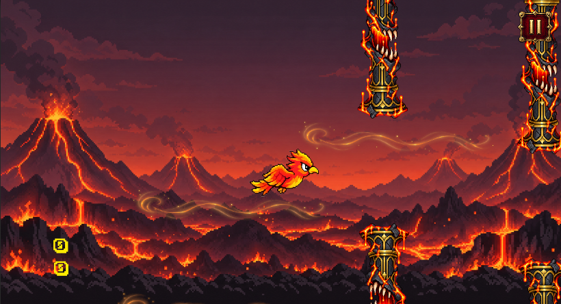
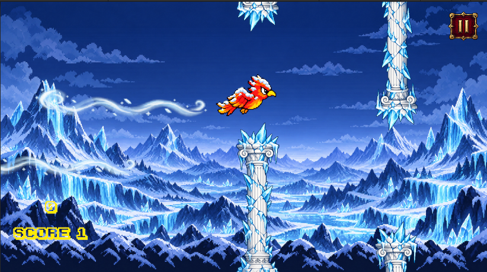
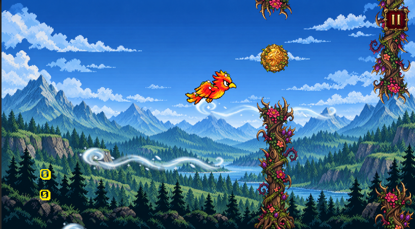

# Pyre Flight 🔥

A Flappy Bird-inspired 2D game built using **Unity and C#**.

This project is a beginner-friendly guide to learning Unity by recreating a playable game, from basic mechanics to multiple levels, animations, and environments.

## 🎮 Gameplay Preview

| Level 1: Infernal Peaks | Level 2: Frozen Heights | Level 3: Highland Forest |
|:---:|:---:|:---:|
|  |  |  |

## 🛠️ 1. Requirements

Install the following before starting:

1. **[Unity Hub](https://unity.com/download)** – Install Unity Hub and the Unity Editor version used for this project.
2. **[Visual Studio](https://visualstudio.microsoft.com/)** – Install Visual Studio with the *Game development with Unity* workload.

## 📥 2. Getting Started

1. Clone or download this repository.
2. Open Unity Hub and create a new **2D Core** project.
3. Copy the repository's `Assets` folder into your Unity project's folder.
4. Open the project in Unity and allow the assets to import.

## 🚀 3. Build the Basic Game

Follow the tutorial below to create the basic Flappy Bird gameplay.

**Primary Tutorial:**

[Game Maker's Toolkit – The Unity Tutorial For Complete Beginners](https://youtu.be/XtQMytORBmM)

Follow the video to implement:

- Bird movement and gravity.
- Jump/flap controls.
- Obstacles and random spawning.
- Collision detection.
- Score tracking.
- Game Over and restart functionality.

## 🌍 4. Expand the Game – Create Three Levels

The tutorial covers the basic game, but not the additional features shown in the preview. Implement the following yourself using the provided assets.

**Step 1 – Organize the Scenes**
- Create a Main Menu scene.
- Create three gameplay scenes: Level 1, Level 2, and Level 3.
- Create a Game Over scene or panel.
- Add the scenes to Unity's Build Settings / Build Profiles.

**Step 2 – Create Level Environments**

Use the provided background and environment assets to create three distinct levels:

- **Level 1 – Infernal Peaks:** Volcanic mountains, lava, and fire-themed obstacles.
- **Level 2 – Frozen Heights:** Snow-covered mountains, ice, and frozen obstacles.
- **Level 3 – Highland Forest:** Green mountains, forests, and nature-themed obstacles.

**Step 3 – Add Bird Animations**
- Import the provided bird sprite frames.
- Create animation clips for flying and other required movements.
- Configure looping animations using the Animator.
- Adjust the bird's movement and animation to work together.

**Step 4 – Configure Obstacles**
- Create obstacle prefabs for each environment.
- Adjust obstacle positions and gaps.
- Configure colliders and scoring triggers.
- Add level-specific visual elements.

**Step 5 – Implement Level Progression**
- Connect the three levels.
- Configure the conditions for progressing to the next level.
- Add scene transitions.
- Ensure scoring and restart functionality work correctly.

**Step 6 – Polish the Game**
- Add suitable sound effects and background music.
- Add UI elements and level indicators.
- Test collisions, animations, scoring, and scene transitions.
- Fix any gameplay issues.

## 📁 5. Assets

The repository includes the graphical assets required for the project.

- Bird sprites and animation frames.
- Backgrounds and environment sprites.
- Obstacles and level-specific graphics.
- Other visual elements used in the game.

Import these assets into your Unity project's `Assets` folder and organize them as needed.

## 📦 6. Build & Play

Once development is complete:

1. Open Unity's Build Profiles.
2. Select your target platform.
3. Configure the scenes included in the build.
4. Build and run your game.

---

Made with ❤️ using Unity & C#

